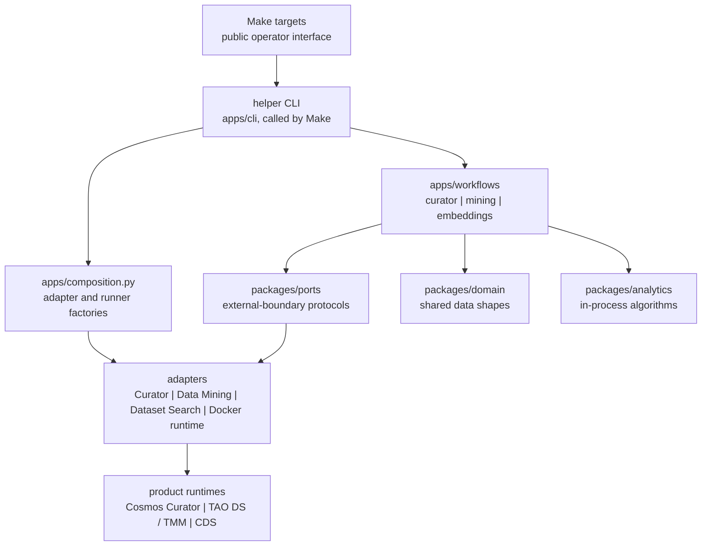
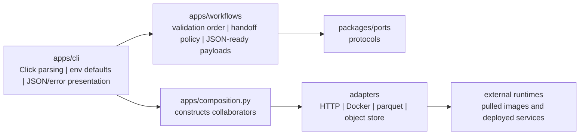

<!--
SPDX-FileCopyrightText: Copyright (c) 2026 NVIDIA CORPORATION & AFFILIATES. All rights reserved.
SPDX-License-Identifier: Apache-2.0
-->

# Clean Architecture

Dependency direction inside this repository. Make is the operator
interface; everything below it is contributor detail.

Layers from Make down to the product runtimes:

How the helper CLI wires a single command:

