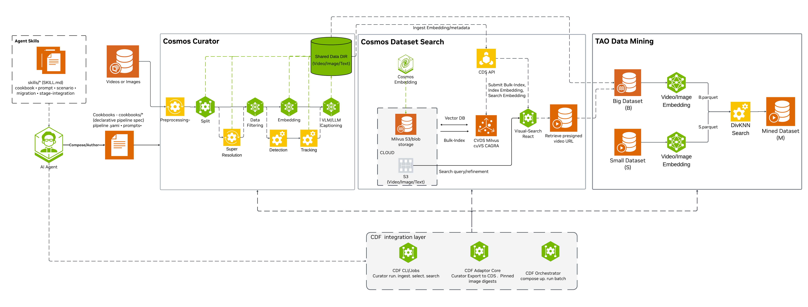
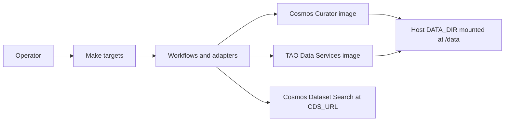
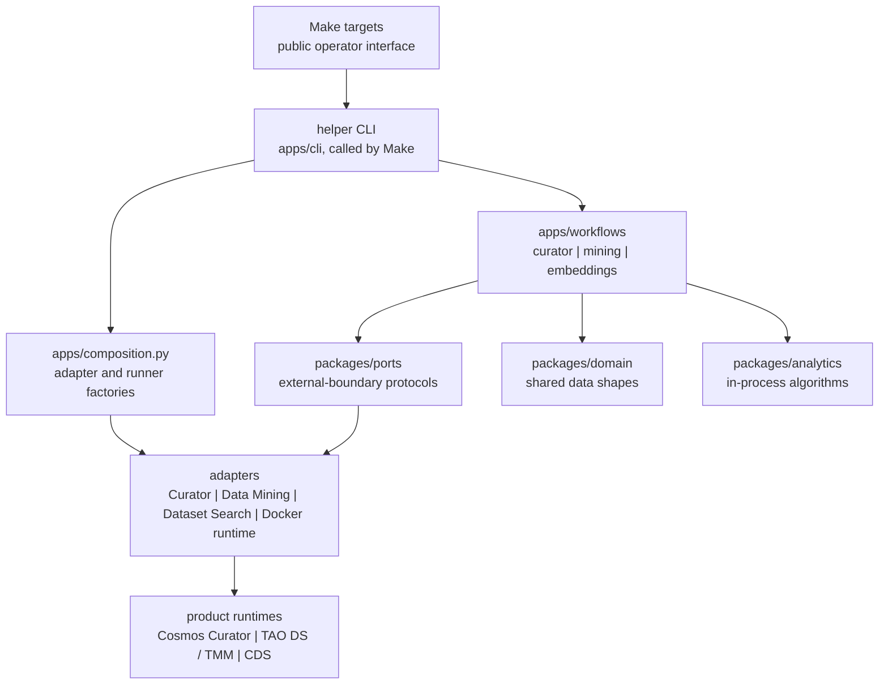
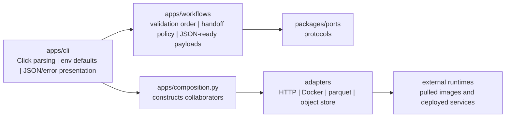
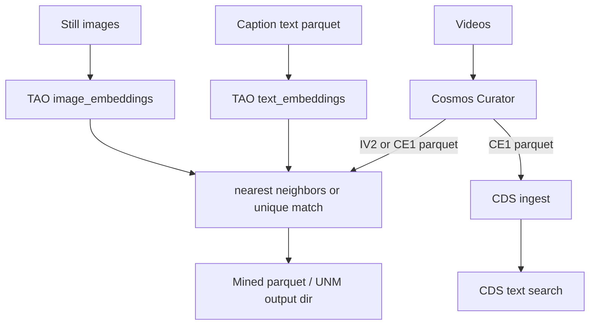

<!--
SPDX-FileCopyrightText: Copyright (c) 2026 NVIDIA CORPORATION & AFFILIATES. All rights reserved.
SPDX-License-Identifier: Apache-2.0
-->

# Architecture

## System at a glance

Overall **Cosmos Data Factory Curation and Retrieval** architecture
(Cosmos Curator, Cosmos Dataset Search, and Data Mining):



Cosmos Curator video/image curation pipeline only (split, caption, embed,
dedup, shard):


Operator and orchestration layers:



| Layer | Role |
|-------|------|
| **Make** | Public interface (`make help`) |
| **apps/cli** | Helper CLI that Make calls: argument parsing, JSON and error output |
| **apps/workflows** | Validation order, handoff policy, JSON-ready results |
| **packages** | Domain types, ports (external-boundary protocols), in-process analytics |
| **adapters** | Docker argument construction, parquet prep, path mounts, CDS and Cosmos-Embed1 HTTP clients |
| **Pulled images** | Cosmos Curator; TAO Toolkit Data Services (`embedding`, `tmm`) |
| **Cosmos Dataset Search** | Local Compose on a laptop; elsewhere a separately deployed service reached through `CDS_URL` |

There is no shared scheduler or cross-step state in this repository. Operators
(or an external orchestrator) sequence Make targets. CDS on a laptop is
Compose; anywhere else CDS is a prerequisite endpoint deployed from its own
repository and reached through `CDS_URL`.

## Code layers

Dependency direction inside this repository. Make is the operator
interface; everything below it is contributor detail.



How the helper CLI wires a single command:



## Product engines

| Engine | Generates embeddings? | Mining? | Typical Make entry |
|--------|----------------------|---------|-------------------|
| Cosmos Curator | Yes (IV2, CE1, image annotate) | No | `make run-pipeline`, `make run_image_pipeline` |
| TAO `embedding` | Yes (image and text) | No | `make run-image-embeddings`, `make run-text-embeddings` |
| TAO `tmm` | No | Yes (NN and UNM) | `make run-data-mining-select`, `make run-data-mining-unique-match` |

TMM **consumes** precomputed embeddings. It does not generate them.

## Data flow



Declare the producer family when mining with:

```text
TDM_EMBEDDING_BACKEND=iv2|ce1|clip|siglip
```

Vector values alone cannot prove their producer family. Compatibility checks
use the declared backend.

## S and B (target and source)

| Symbol | Name | Role |
|--------|------|------|
| **S** | Target / query set | Items you want matches **for** |
| **B** | Source / candidate pool | Items you search **in** |

Typical layout under `DATA_DIR`:

```text
data/nearest-neighbor-mining/
  S.parquet    # targets
  B.parquet    # candidates
```

Each parquet must provide filepath-like identity (`filepath` or `file_name`,
or a custom column name you declare) and an embedding vector column (default
`embedding`, or a custom name you declare).

### Nearest neighbors outcome

For each S row, return up to `TOPN` closest B rows under the chosen metric,
optionally filtered by `DISTANCE_THRESHOLD` and `FILTER_BY_LABEL`.

### Unique neighbor matching outcome

Greedy unique assignment: selected B items are not reused across S demands
beyond the allocation policy. Output directory contains
`final_unique_files.parquet` after a successful live run, and often
`summary.json`.

| Policy | Extra inputs |
|--------|--------------|
| `global` | None beyond S/B and count/metric knobs |
| `class_stratified` | Detection files, `DETECTION_FORMAT=coco\|kitti`, `RARE_CLASS_LIST` |

Detection shapes:

- `coco` — single COCO JSON **file**
- `kitti` — **directory** of per-image `.txt` label files

## Experiment specs

Every TAO Data Services `embedding` and `tmm` run requires
`-e/--experiment_spec_file`.

- Cookbook YAML (`TMM_CONFIG_FILE`, `TMM_UNM_CONFIG_FILE`,
  `IMAGE_EMBEDDING_CONFIG`, `TEXT_EMBEDDING_CONFIG`) is mounted read-only.
- Direct Make variables are validated and written to a temporary read-only
  spec.

## CDS Path D

Local compose, CE1 ingest, and text search (public GA):
[Cosmos Dataset Search](../user-guide/operations-cds.md).

CDS is a separate engine from Data Mining. Curator CE1 feeds Path D.
InternVideo2 and CLIP/SigLIP remain Path C (mining) unless a CDS deployment
documents otherwise.
The public profile adds `deploy/compose/docker-compose.embed.yml`,
which serves Cosmos-Embed1 at host port 9000 for text search.
